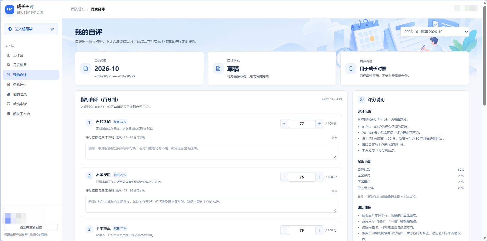

# 360° 环评系统

用于管理组织成员、月度环评、评分校准、结果发布和反馈复核。部署时使用自己的数据库和飞书应用。

## 产品截图

### 个人工作台


### 月度自评



### 月评周期管理


## 本地启动

需要 Docker Compose。在本目录复制 `.env.example` 为 `.env`，设置 `DOCKER_SESSION_SECRET` 和 `INITIAL_SETUP_TOKEN`。分别生成两个独立的随机值，每个至少 32 个字符。已安装 Node.js 时，每次运行以下命令可生成一个：

```sh
node -e "console.log(require('node:crypto').randomBytes(32).toString('hex'))"
```

可通过 `INITIAL_ORG_NAME` 和 `INITIAL_ADMIN_NAME` 指定首个组织和管理员的名称。首次启动运行：

```sh
docker compose up -d --build --wait
```

打开 [环评系统](http://localhost:5373)，输入初始化令牌进入管理员设置。令牌仅可使用一次。这个流程创建一个管理员和默认评分规则，正式成员通过通讯录导入。

## 接入飞书

1. 在飞书开放平台创建并发布企业自建应用。开通用户登录、读取应用可见范围内的部门和成员所需权限，并将相关人员加入应用可用范围。使用通知时另开通机器人发消息的权限。
2. 在「系统设置 → 用户与飞书绑定」复制回调地址，加入飞书应用的 OAuth 重定向地址。在页面录入该应用的 App ID、App Secret 和实际的租户标识 `tenant_key`，点击「测试连接并保存」。连接测试读取通讯录。
3. 在「绑定当前管理员」中录入自己在该应用下的 Open ID。先用另一个浏览器会话测试飞书登录，再退出初始化会话。
4. 预览名单，按部门筛选，勾选需要导入的成员。确认后，系统为新增成员创建账号、飞书绑定和可识别的主部门归属。现有已绑定成员可更新姓名。对于同名账号、已撤销绑定或已停用账号，先核对冲突。部门归属需要调整时，请到组织架构操作。

同一个飞书人的 Open ID 在不同应用下可能不同。该版本支持单次部署接入一个飞书应用，可在界面更新同一应用的密钥。保管好 `DOCKER_SESSION_SECRET`，恢复数据库备份时也需要它来解密飞书配置。

## 部署和开发

- Compose 默认仅向本机开放 Web `5373`、API `3200` 和 PostgreSQL `56432`。停止服务并保留数据可运行 `docker compose stop`。
- 对外部署时使用 HTTPS 反向代理，把 `DOCKER_APP_ORIGIN` 设置为实际的 HTTPS 域名，并设定 `DOCKER_APP_ENV=production`。在飞书应用中同步更新回调地址。
- 本地源码开发需要 Node.js 22+ 和 pnpm 10.6.2。项目命令包括 `pnpm build`、`pnpm dev:api`、`pnpm dev:web` 和 `pnpm dev:worker`。数据库测试使用专用测试库，参见 `.env.example`。

发布此源码副本前，请完成公司对外授权及素材授权确认，并添加选定的开源许可证。
